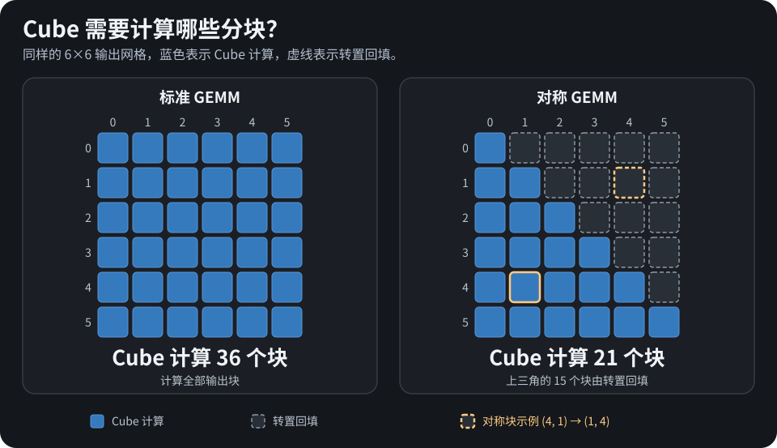
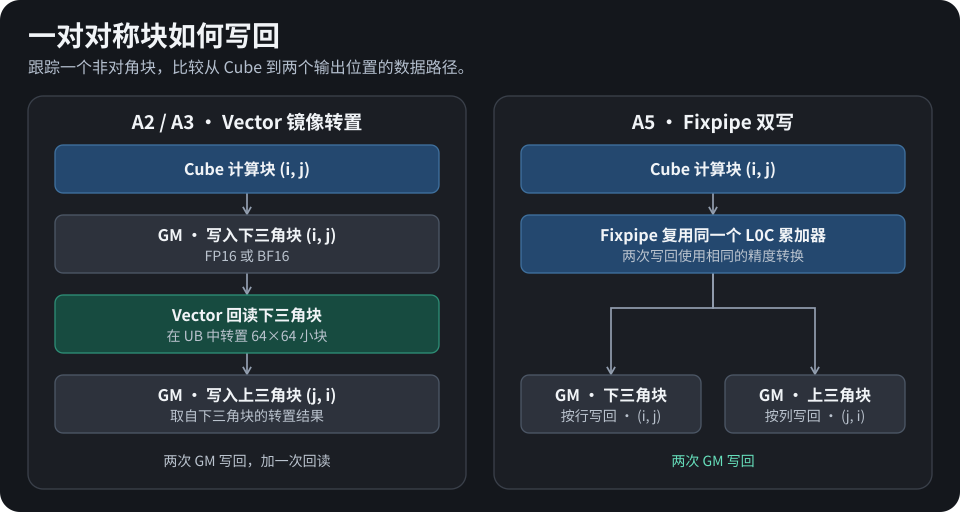
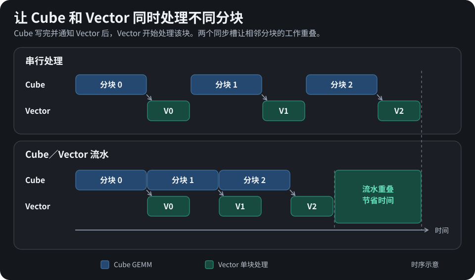
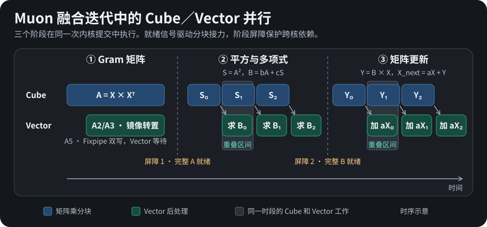
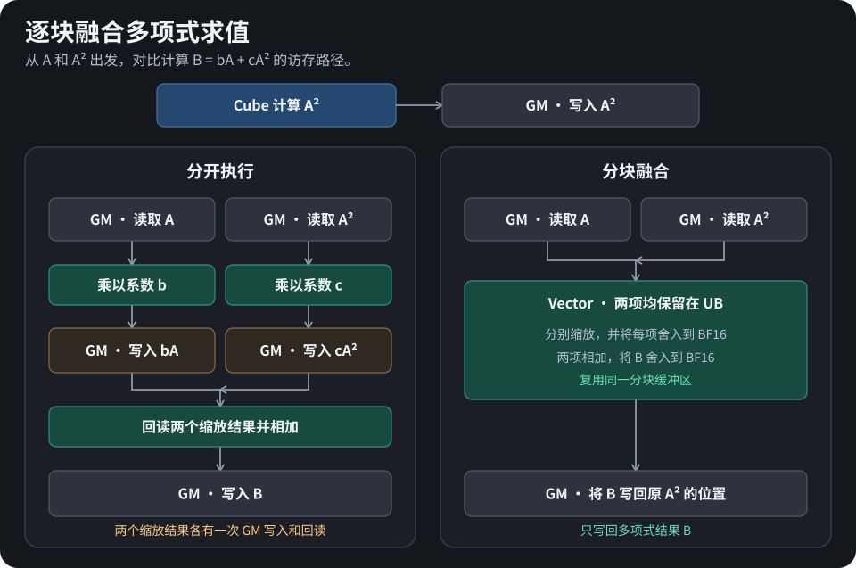

# Ascend C 对称 GEMM 与 Muon 融合 Newton–Schulz

HyperParallel 的对称 GEMM 用于计算 `X @ X.mT` 和对称矩阵的平方 `A @ A`。
Muon 的 Ascend C 后端在每轮 Newton–Schulz 迭代中复用这套实现，并将两次对称乘、
多项式求值和矩阵更新放在一次内核提交里。

## 只计算下三角分块

图中的橙框标出一对对称块。Cube 计算下三角块 `(4, 1)`，转置后写入上三角块 `(1, 4)`。
Cube 大块最大为 256×256。对角块完整计算，块内每个元素保留各自的 GEMM 舍入结果。

每边有 `T` 个块时，Cube 需要计算的块数从 `T²` 降到 `T(T + 1)/2`。图中少算了 15 个块。
对于由等大块组成的大矩阵，节省的 Cube 算术量接近一半。实际耗时还取决于结果写回、
镜像转置和边缘填充。

每个 Cube 核按固定步长遍历任务编号，在设备侧解出批次、行和列，省去准备和传输任务表的开销。
独立算子启动的 Cube 核数取批内三角任务总数与可用核数的较小值。[任务索引](schedule.h) · [分块规划](plan.cpp)

## 950 用 Fixpipe 双写，省去镜像回读

- **A2（910B）和 A3（910_93xx）**。Cube 将下三角块写入全局内存（GM）。
  两个 Vector 核交替分工，每个核一次处理 64 行。它们将写好的 FP16 或 BF16 数据读入
  统一缓冲区（UB），按 64×64 小块转置后写入上三角。[Vector 镜像实现](mirror.h)
- **A5（950PR/950DT）**。Matmul 写回回调从同一个 L0C 累加器通过 Fixpipe 分别按行和按列写出，
  两次写回使用相同的 FP16 或 BF16 转换。这样省去一次 GM 回读和 Vector 转置，
  独立对称 GEMM 只启动 Cube 核。[Fixpipe 回调](product.h) · [内核入口](fused.cpp)

## 让 Cube 计算与 Vector 后处理重叠

Cube 写完第 0 块并发出就绪信号后，Vector 可以处理第 0 块，Cube 同时计算第 1 块。
内核交替使用两个同步槽。重用某个槽之前，Cube 等待两个 Vector 核都确认消费完毕，
因此 Vector 较慢时 Cube 会在槽重用处等待。A2/A3 的镜像转置和 Muon 的融合后处理
都使用这套握手。[分块同步](schedule.h)

## 融合一轮 Muon 迭代

一轮迭代先对归一化后的 `X` 求 Gram 矩阵 `A = X @ X.mT`，再计算
`S = A @ A` 和多项式 `B = b * A + c * S`，最后由 `Y = B @ X` 得到
更新结果 `X_next = a * X + Y`。其中 `A` 和 `S` 都通过对称 GEMM 计算。

### 一次内核提交内的 Cube／Vector 并行

- **平方与多项式阶段**。Cube 写完 `S₀` 后，Vector 读取对应的 `A₀` 和 `S₀`，
  将 `B₀` 写回原来的 `S₀` 位置。Cube 可以同时计算下一块 `S₁`。
  A2/A3 由 Vector 将 `B` 的下三角块镜像到上三角。在 950 上，Fixpipe 已将 `S` 的一对对称块写好，
  两个 Vector 核各处理其中一块。
- **矩阵更新阶段**。Cube 写完 `Y₀` 后，Vector 就可以加上同一区域的 `aX` 并原位写回，
  Cube 可以同时计算 `Y₁`。这一步使用矩形更新的任务数确定启动核数，上限为可用 Cube 核数，
  宽矩阵的更新因此可以用上更多核。[启动规划](plan.cpp)
- **阶段之间同步**。平方阶段等待完整的 `A`，矩阵更新阶段等待完整的 `B`。
  Cube 完成自己的计算，并等该阶段涉及的 Vector 写回结束后，再进入跨 Cube 核的阶段屏障。
  950 为两个 Vector 核分别使用独立的一组同步标志，并以批量调度启动参与屏障的计算块。[融合内核](fused_ns.cpp)

### 省去两个缩放结果的全局内存往返

Cube 将平方结果 `S` 写回 GM，Vector 将 `S` 和 `A` 的当前块读入 UB。
分开执行时，缩放结果 `b * A` 和 `c * S` 各需一次 GM 写入和回读。
融合后，两个缩放结果都留在 UB，Vector 按 Torch 分开执行时的方式先将每项舍入到 BF16，
相加后将 `B` 写回原来的 `S` 缓冲区。[Vector 后处理](fused_ns.cpp)

Muon 在第一轮前做一次归一化，使用 `X` 较短的一边作为方阵边长。两块方阵缓冲区跨轮复用，
归一化后的输入与更新输出缓冲区在相邻轮次交换角色。[Muon 回调](../../../../core/optimizer/ascendc_ns.py)

## 适用条件

独立对称 GEMM 支持 FP16 和 BF16 的二维矩阵或三维批量矩阵，仅用于前向。
形状满足对齐要求时，32 字节对齐的连续张量或其末两维转置视图可直接传给内核。
必要时，调度器将方阵边长填充到 64 的倍数、归约维填充到 16 的倍数，并按需要打包输入或拷回输出。
两个算子都按 Host 线程缓存分块参数，并在当前 NPU 流上提交。[Torch 调度](torch_op.cpp)

通过 `muon_ns_backend="ascendc"` 启用融合后端。它在 Ascend A2、A3 和 A5 上处理满足设备
索引与步幅限制的非空 BF16 矩阵或批量矩阵，矩阵的两个维度都须为 64 的倍数。
其余输入走原生 Muon 迭代。[构建和用法](../../README.md#ascend-c-symmetric-gemm)
